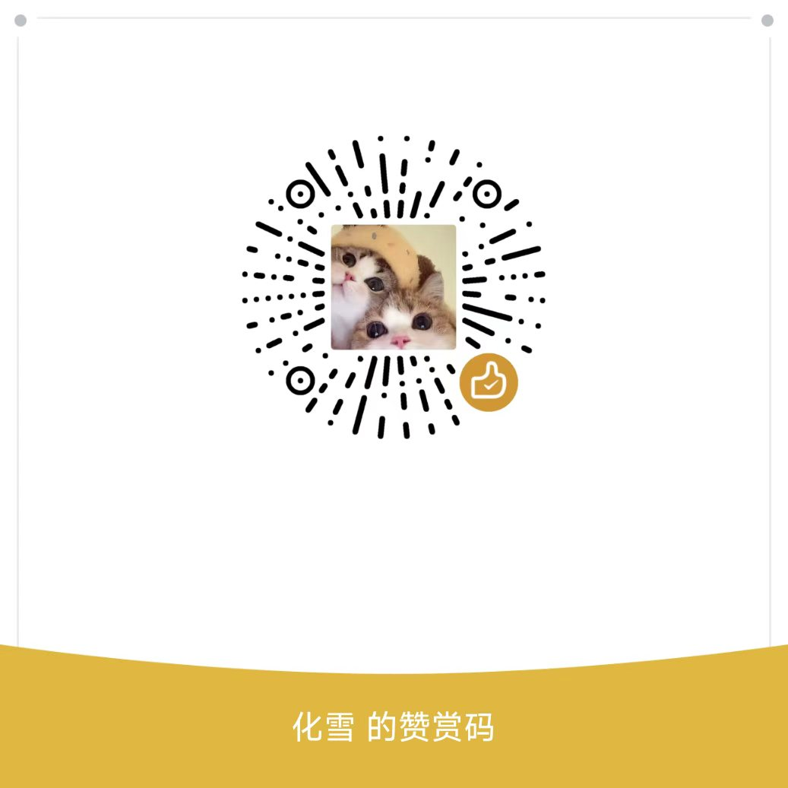

[中文](../../README.md) | English

# ClipSync Module

LAN clipboard synchronization for Android ARM64 devices using KernelSU or Magisk 28+. Version `0.1`.

- Plain text, multiline content and Emoji.
- TCP synchronization with write acknowledgements and automatic reconnection.
- WebUI for device discovery, manual IP entry and pause/resume.

## Installation

1. Install the same module ZIP on both devices and reboot.
2. Connect both devices to the same Wi-Fi network.
3. Open the module's WebUI in KernelSU and scan. Use **添加 IP** if discovery fails.
4. Once connected, copy on one device and paste on the other.

Use a trusted LAN. The module action button also toggles synchronization.

## Build

Build the native daemon with CMake and Ninja. Set `ANDROID_NDK_HOME` to the Android NDK directory.

```bash
git clone https://github.com/Techuouo520/ClipSync-Module.git
cd ClipSync-Module
cmake --preset release
cmake --build --preset release
```

Output — `build/android/clipsyncd`.

| Preset | Description |
|---|---|
| `debug` | Enable debugging symbols and runtime logs |
| `release` | Optimize the binary and strip symbols |

`scripts/build.ps1` builds the complete module ZIP at `build/clipsync-magisk.zip`. Published packages are listed under [Releases](https://github.com/Techuouo520/ClipSync-Module/releases).

## License

Copyright (C) 2026 Techuouo520. [AGPL-3.0-only](../../LICENSE).

## Bilibili & Sponsor

[Tech悠悠](https://space.bilibili.com/1934537611)



[USDT-TRC20](https://tronscan.org/#/address/TRKeWXWc1GL7ARE1sX5rBDcYg9yStFsmnU) · [USDT-Solana](https://solscan.io/account/BrKPdDdF8NY8k1f4A7RfN1inSDsxZ2d1atDHvGLjp23G)
